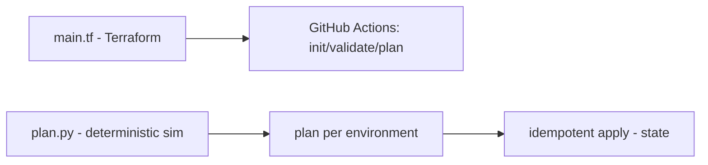

# iac-terraform-github-actions

**English** · [Português (Brasil)](README.md)

[](#) [](#) [](#) [](#) [](LICENSE)

## What it is

An **Infrastructure as Code (IaC) MVP with Terraform + GitHub Actions**: a `main.tf` (no embedded credentials, uses the built-in `local_file` provider) defining `environment` and `prefix`, a CI pipeline running `terraform init/validate/plan`, and a Python utility that **deterministically simulates** the Terraform plan and the **idempotent apply** without calling the binary. It is an IaC/CI lab.

## Status

A working IaC/CI lab with 10 tests and a Terraform pipeline in GitHub Actions.

## Features

- **Real `main.tf`**: defines variables (`environment`, `prefix`), `local_file` resources, Terraform version `>= 1.5, < 2.0`.
- **Deterministic plan/apply simulation** (`src/iac_actions/plan.py`): reads HCL, extracts resource blocks, renders a plan per environment and applies **idempotently** (does not duplicate already-present resources).
- **CI (GitHub Actions)**: `terraform init -input=false`, `validate`, `plan` and `show` (Hashicorp setup-terraform v3, Terraform 1.5).
- **No credentials**: uses only the built-in `local_file` provider.

## Architecture

`main.tf` (IaC) + a Python script that simulates plan/apply behavior (HCL structure → plan → idempotent state) + a GitHub Actions pipeline.



## Stack

- Python ≥ 3.9 (deterministic simulation)
- Terraform ≥ 1.5 (via `main.tf` and CI)
- GitHub Actions (pipeline)
- pytest (dev)

## Repository layout

```
iac-terraform-github-actions/
├── main.tf                  # IaC: variables + local_file
├── pyproject.toml · BRIEF.md
├── src/iac_actions/
│   └── plan.py              # deterministic plan/apply
├── tests/test_tf_actions.py
├── .github/workflows/ci.yml # init/validate/plan/show
└── LICENSE                  # MIT
```

## Prerequisites and installation

- Terraform ≥ 1.5, < 2.0 (for the CI/IaC)
- Python ≥ 3.9 (for the simulation and tests)

```bash
pip install -e .
```

## How to run

There is no installable CLI; use the simulation programmatically (verified by the agent):

```bash
PYTHONPATH=src python -c "from iac_actions.plan import read_hcl, extract_blocks, render_plan; print(render_plan(extract_blocks(read_hcl('main.tf')), 'dev'))"
# Terraform plan (ambiente=dev)
#   Planned resources:
#     + local_file.manifest
```

If Terraform is installed:

```bash
terraform init -input=false && terraform validate && terraform plan
```

## Tests and quality

Real command (verified by the agent):

```bash
python -m pytest tests/
# 10 passed
```

CI: `.github/workflows/ci.yml` runs the Terraform pipeline (init/validate/plan/show) plus the tests.

## Technical decisions and trade-offs

- **Simulation without calling the Terraform binary**: fast and reproducible tests; the trade-off is not validating the real plan outside CI.
- **`local_file` provider (no credentials)**: keeps the lab safe and locally runnable; it does not provision real cloud resources.
- **Idempotent apply**: mirrors Terraform's expected behavior (not re-creating what already exists).

## Known limitations and roadmap

- The simulation understands basic HCL structure; more complex Terraform configs are out of scope.
- It does not apply to a real provider (only demonstrates and validates with `local_file`).
- CI installs Terraform but the Python simulation is independent of it.

## Development process

An individual project by Kelvin Oliveira, built with orchestrated AI agents and reviewed by the author. The IaC/CI architecture and the review are the author's.

## License and author

MIT — Copyright (c) 2026 Kelvin Rebelo de Oliveira.

**Author**: [Kelvin Oliveira](https://github.com/KelvinOliveiraCode) · [Portfolio](https://kelvinoliveiracode.github.io/portfolio/)
