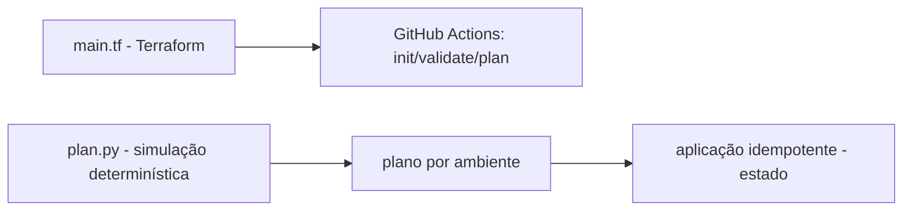

# iac-terraform-github-actions

[English](README.en.md) · **Português (Brasil)**

[](#) [](#) [](#) [](#) [](LICENSE)

## O que é

MVP de **Infraestrutura como Código (IaC) com Terraform + GitHub Actions**: um `main.tf` (sem credenciais embutidas, usa o provedor `local_file`) que define `environment` e `prefix`, um pipeline de CI que roda `terraform init/validate/plan`, e um utilitário Python que **simula de forma determinística** o plano e a **aplicação idempotente** do Terraform sem chamar o binário. É um laboratório de IaC/CI.

## Status

Laboratório funcional de IaC/CI com 10 testes e pipeline Terraform no GitHub Actions.

## Funcionalidades

- **`main.tf`** real: define variáveis (`environment`, `prefix`), recursos com `local_file`, versão do Terraform pegando `>= 1.5, < 2.0`.
- **Simulação determinística de plan/apply** (`src/iac_actions/plan.py`): lê HCL, extrai blocos de recursos, renderiza plano por ambiente e aplica de forma **idempotente** (não duplica recursos já presentes).
- **CI (GitHub Actions)**: `terraform init -input=false`, `validate`, `plan` e `show` (Hashicorp setup-terraform v3, Terraform 1.5).
- **Sem credenciais**: usa apenas o provedor built-in `local_file`.

## Arquitetura

`main.tf` (IaC) + script Python que simula o comportamento de plan/apply (estrutura HCL → plano → estado idempotente) + pipeline GitHub Actions.



## Stack

- Python ≥ 3.9 (simulação determinística)
- Terraform ≥ 1.5 (via `main.tf` e CI)
- GitHub Actions (pipeline)
- pytest (dev)

## Estrutura do repositório

```
iac-terraform-github-actions/
├── main.tf                  # IaC: variáveis + local_file
├── pyproject.toml · BRIEF.md
├── src/iac_actions/
│   └── plan.py              # plan/apply determinístico
├── tests/test_tf_actions.py
├── .github/workflows/ci.yml # init/validate/plan/show
└── LICENSE                  # MIT
```

## Pré-requisitos e instalação

- Terraform ≥ 1.5, < 2.0 (para o CI/IaC)
- Python ≥ 3.9 (para a simulação e testes)

```bash
pip install -e .
```

## Como executar

Não há CLI instalável; use a simulação programaticamente (verificado pelo agente):

```bash
PYTHONPATH=src python -c "from iac_actions.plan import read_hcl, extract_blocks, render_plan; print(render_plan(extract_blocks(read_hcl('main.tf')), 'dev'))"
# Terraform plan (ambiente=dev)
#   Planned resources:
#     + local_file.manifest
```

Se o Terraform estiver instalado:

```bash
terraform init -input=false && terraform validate && terraform plan
```

## Testes e qualidade

Comando real (verificado pelo agente):

```bash
python -m pytest tests/
# 10 passed
```

CI: `.github/workflows/ci.yml` roda o pipeline Terraform (init/validate/plan/show) + testes.

## Decisões técnicas e trade-offs

- **Simulação sem chamar o binário Terraform**: testes rápidos e reprodutíveis; o trade-off é não validar o plano real fora do CI.
- **Provedor `local_file` (sem credenciais)**: mantém o lab seguro e executável localmente; não provisiona recursos reais de nuvem.
- **Aplicação idempotente**: reflete o comportamento esperado do Terraform (não re-criar o que já existe).

## Limitações conhecidas e roadmap

- A simulação entende a estrutura HCL básica; configs mais complexas do Terraform ficam fora dela.
- Não aplica em provedor real (apenas demonstra e valida com o `local_file`).
- O CI instala Terraform mas a simulação Python é independente dele.

## Processo de desenvolvimento

Projeto individual de Kelvin Oliveira, construído com agentes de IA orquestrados e revisado pelo autor. A arquitetura de IaC/CI e a revisão são do autor.

## Licença e autor

MIT — Copyright (c) 2026 Kelvin Rebelo de Oliveira.

**Autor**: [Kelvin Oliveira](https://github.com/KelvinOliveiraCode) · [Portfólio](https://kelvinoliveiracode.github.io/portfolio/)
